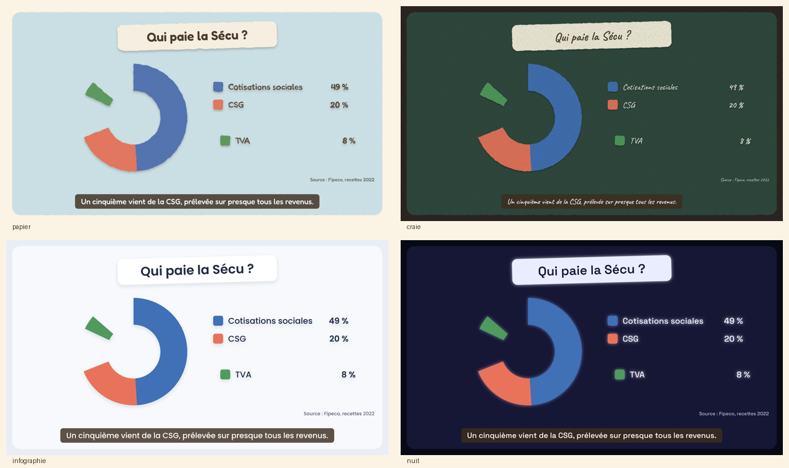

# documentaire-motion-design

A Claude skill that turns a topic into a **documentary / explainer video made of coded motion graphics**: every frame is drawn with React + SVG ([Remotion](https://www.remotion.dev/)), like a video-game scene or an animated slide, then rendered to MP4. No AI-generated images.



## What you get
- 1080p MP4 with voice-over and subtitles, each visual synced to the word that mentions it
- 4 styles, picked at render time: `papier` (paper cut-out), `craie` (chalkboard), `infographie` (flat data-journalism), `nuit` (night glow)
- YouTube thumbnail (1280x720), title ideas and a description with chapters computed from real scene timings
- Voice options: your own ElevenLabs track (auto-cut into one clip per scene), free edge-tts voices, or a Google TTS fallback
- Adjustable pacing: speed the voice up (e.g. +12%) and tighten the gap between scenes

## Install
Download the zip from the [latest release](https://github.com/Sami-Fd/documentaire-motion-design/releases/latest) and add it as a skill in Claude (Settings → Capabilities → Skills), or copy the `documentaire-motion-design` folder into your skills folder:

```bash
git clone https://github.com/Sami-Fd/documentaire-motion-design.git
# personal skill
cp -r documentaire-motion-design/documentaire-motion-design ~/.claude/skills/
# or project skill
cp -r documentaire-motion-design/documentaire-motion-design .claude/skills/
```

## Use
Ask Claude something like: *"Make a 2-minute documentary on how the water cycle works, `nuit` style."*
Claude researches, writes the narration, codes the scenes, renders a preview sheet to check the layout, then renders the MP4.

## Requirements
Node 18+, ffmpeg, Python 3 (for the voice scripts), Chrome/Chromium for Remotion rendering.

## Notes
- The skill's instructions and on-screen text are in French; Claude can produce videos in any language.
- Remotion is free for individuals and small teams; larger companies need a Remotion company license (see [remotion.dev/license](https://www.remotion.dev/license)).

## Contributing
Fixes and suggestions are welcome: see [CONTRIBUTING.md](CONTRIBUTING.md).

## Changelog
See [CHANGELOG.md](documentaire-motion-design/CHANGELOG.md).

## License
[MIT](LICENSE)
